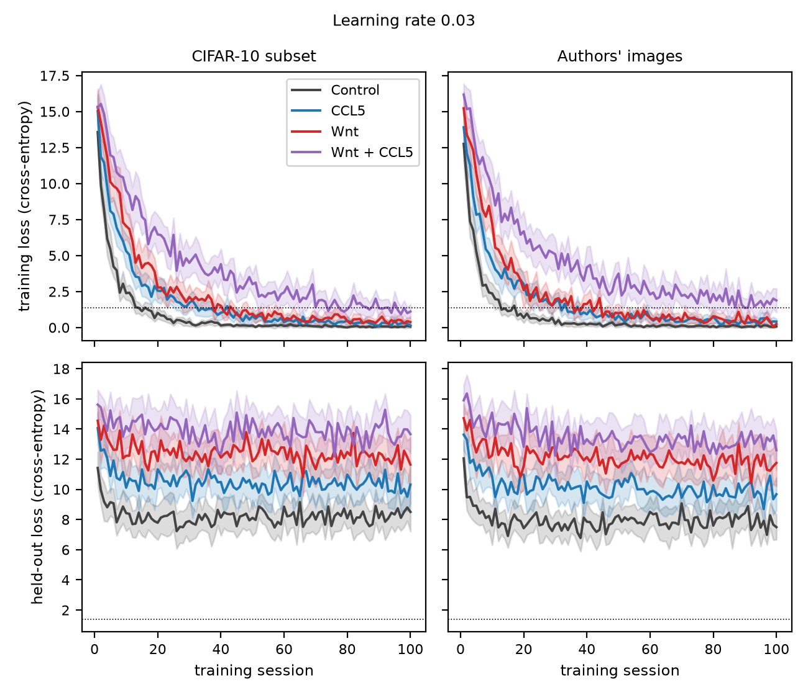
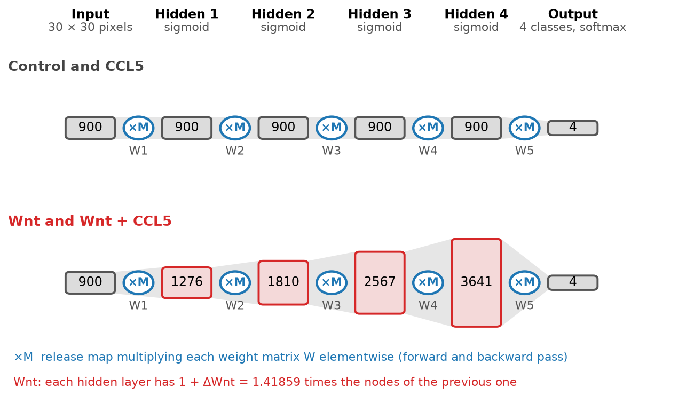

# ASD Neurodevelopment Model

[](https://github.com/jmamodeo/asd-neurodev-model/actions/workflows/tests.yml)
[](https://doi.org/10.5281/zenodo.24344589)
[](LICENSE)

A Python neural-network model of how elevated Wnt and mTOR-activated CCL5 signaling in autism spectrum disorder (ASD) could slow learning in a visual image-classification network. Written in NumPy; accompanies the paper in [`docs/paper/paper.pdf`](docs/paper/paper.pdf).



*Training loss (top) and held-out loss (bottom) over 100 sessions, mean and 95% interval over 20 seeded networks per condition (paper Figure 3). Both perturbations slow the fall in training loss, and together they slow it more than the sum of their separate effects.*

## Contents

- [Background](#background)
- [Quick start](#quick-start)
- [`main.py` or `reproduce.py`?](#mainpy-or-reproducepy)
- [How the model works](#how-the-model-works)
- [Repository map](#repository-map)
- [Installation](#installation)
- [Data](#data)
- [Running one network (`main.py`)](#running-one-network-mainpy)
- [Reproducing the paper's figures and tables (`reproduce.py`)](#reproducing-the-papers-figures-and-tables-reproducepy)
- [Methods-to-code map](#methods-to-code-map)
- [Tests](#tests)
- [Results at a glance](#results-at-a-glance)
- [Citation](#citation)
- [Limitations](#limitations)
- [License](#license)

## Background

ASD is a heterogeneous neurodevelopmental disorder, and vision is one of the senses particularly affected. Two pathways, Wnt and mTOR, have been identified as high risk. Wnt proteins stabilize synapses, and mTOR activates CCL5, which stimulates glutamate release. In excess, these proteins cause unnecessary synapses to form and survive, a hallmark of ASD.

The paper uses visual processing as a base to examine the effect of both proteins at ASD levels in a neural network, as a way to study population dynamics rather than only single cells. It reports that both perturbations slow the reduction of training loss, that the two together slow it more than the sum of their separate effects, and that held-out classification accuracy stays near chance because the image sets are very small.

## Usage

There is one way to do each task. Run every command from the repository root, in a virtual environment (Python 3.11; 3.12 also works with the pinned versions). The runtime pins live in `requirements.txt`; `pyproject.toml` reads them, so `pip install -e .[test]` is the one install command (not a separate `pip install -r requirements.txt` route).

```bash
git clone https://github.com/jmamodeo/asd-neurodev-model.git
cd asd-neurodev-model
python3.11 -m venv venv && source venv/bin/activate
pip install -e .[test]
```

| Task | The one command |
|---|---|
| Install (once) | `pip install -e .[test]` |
| Train and test one network | `python main.py` (needs images in `image_set/`, see [Data](#data); options: `--learning-rate`, `--sessions`, `--wnt-delta`, `--ccl5-delta`) |
| Download CIFAR-10 images for `main.py` (optional, [Data](#data)) | `python scripts/fetch_cifar10.py` |
| Re-create every figure and table of the paper (about 30 seconds) | `python reproduce.py` |
| Re-create one figure or table | `python scripts/figures/<name>.py` (script names are in the [figure table](#reproducing-the-papers-figures-and-tables-reproducepy)) |
| Run the tests | `pytest` |
| Check the code style | `pip install -e .[lint]`, then `ruff check . && ruff format --check .` |
| Rebuild the paper PDF | `pip install -e .[paper]`, then `python docs/paper/build_paper.py` |

Command-line options are spelled out in full; abbreviations are rejected. `reproduce.py` and the figure scripts take the same options: `--quick`, `--retrain`, `--workers N`, `--seeds N`, `--sessions N`, `--original-images DIR` and `--no-fetch` (described [below](#reproducing-the-papers-figures-and-tables-reproducepy)).

## `main.py` or `reproduce.py`?

| | `python main.py` | `python reproduce.py` |
|---|---|---|
| Purpose | Train and test **one** network and watch it learn. The simple, readable way to use the model. | Re-create **everything in the paper**: 4 conditions x 20 seeds x 2 image sets, statistics, tables, figures. |
| Needs images | Yes, in `image_set/` ([Data](#data)) | No. It re-analyzes the finished runs shipped in `reproduce_data/`. Images are only needed with `--retrain`. |
| Random seed | None (runs differ) | Fixed (reruns are identical on the same library versions) |
| Output | Printed loss per session and accuracy, `results/<date> results/training_loss_plot.png` and `training_loss_table.xlsx` | `figures/` and `tables/` |
| Runtime | Seconds to minutes | About 30 seconds from the shipped runs; 2-3 hours per learning rate with `--retrain` |
| Code path | `visual_input.py`, `neural_network.py`, `network_tuning.py`, `loss_outputs.py` in `src/asd_model/` | `src/asd_model/reproduce.py`, which calls `experiment.py` (runs the same `NeuralNetwork` class), `paper_analysis.py` and `model_figures.py` |

## How the model works

- **Input.** `asd_model/visual_input.py` reads each image, converts it to grayscale, resizes it to a square whose side is `sqrt(image_vector_size)`, scales pixel values to 0-1, and flattens it into a vector of length `image_vector_size`. This vector is the input layer.
- **Layer sizes.** Hidden layers start equal in size to the input layer. With `wnt_delta`, each hidden layer gains `int(previous_size * wnt_delta)` nodes over the previous layer, modeling extra synapses (more connections and redundancy). The output layer has one node per class.
- **CCL5 / glutamate release.** For each forward pass, `asd_model/network_tuning.py` draws a release map for every weight matrix from a Poisson distribution with mean `100 * (1 + ccl5_delta)`, divided by 100. The weights are multiplied by these maps, modeling stochastic glutamate release.
- **Learning.** Hidden layers use sigmoid activations and the output layer uses a softmax; loss is cross-entropy. Gradients are clipped to a maximum norm of 1.0. Each session presents all training images once in a freshly shuffled, class-mixed order. The default learning rate is **0.03**; `--learning-rate 0.1` selects 0.1, which makes this network unstable (see the paper's supplementary analysis).
- **Release maps in training and testing.** The release maps multiply the weights in both the forward and the backward pass, and the same distribution is used for training and testing (`use_release_maps` defaults to `True`).
- **Accuracy** is the highest-probability output node compared with the label, on held-out test images (chance = 25% with four classes).

Values used in the paper for ASD: `wnt_delta` = 0.41859 and `ccl5_delta` = 0.40467 (fold changes of 1.41859 and 1.40467 relative to normal). The paper's runs used `image_vector_size` 900 and 100 sessions, whereas `main.py` defaults to an `image_vector_size` of 400.

## Repository map

```
src/asd_model/          The package
  main.py               The code run by `python main.py`: trains and tests one network
  neural_network.py     The NeuralNetwork class: layers, forward pass, backprop, training, testing
  network_tuning.py     Release maps (CCL5), sigmoid and softmax
  visual_input.py       Image loading and label encoding
  loss_outputs.py       Loss plot and spreadsheet written by main.py
  reproduce.py          The code run by `python reproduce.py`: re-creates every paper figure and table
  experiment.py         One seeded run (condition, seed) used by reproduce.py
  paper_analysis.py     Statistics, tables and Figures 3-6, S1-S3
  model_figures.py      Figures 1 and 2 (model schematic, release-map distributions)
main.py, reproduce.py   The two commands you run (they start the package code above)
scripts/figures/        One script per figure or table (fig1 ... fig6, figs1 ... figs3, tables)
scripts/fetch_cifar10.py  Downloads CIFAR-10 and writes the image subset main.py expects
reproduce_data/         The finished runs behind the paper (4 conditions x 20 seeds x 2 image sets)
figures/, tables/       Generated figures and tables (committed)
docs/paper/             Paper (PDF and Markdown source), analysis plan, references, PDF build script
docs/methods_to_code.md Which function implements which step of the paper's Methods
tests/                  pytest tests (conftest.py has the fixture that writes random test images)
requirements.txt        Pinned runtime dependencies (read by pyproject.toml)
pyproject.toml          Package metadata, ruff settings
image_set/, results/    Empty folders for your images and for main.py output
```

## Installation

Python 3.11 is the version used in the paper. The pinned package versions were verified to run `main.py` and `reproduce.py` end to end on Python 3.11 (the tests also pass on 3.12). Current seaborn and pandas releases also run `main.py`, but the pinned versions are the ones the paper's results were produced with.

Install the package in editable mode from the repository root. This puts `asd_model` on the import path and installs the pinned dependencies (the runtime pins live in `requirements.txt`, which `pyproject.toml` reads):

```bash
python3.11 -m venv venv
source venv/bin/activate
pip install -e .[test]      # [test] adds pytest; the pinned dependencies are always installed
```

Editable mode matters: the shipped runs, figures, tables and paper live in the repository and are found relative to it. The commands that write outputs (`reproduce.py`, the figure scripts) always write to the repository's `figures/` and `tables/`, wherever you run them from. `main.py` reads `image_set/` and writes `results/` in the folder you run it from.

## Data

The repository does not ship images. `main.py` expects:

```
image_set/
  train_subset/<class>/
  test_subset/<class>/
```

Class folder names must match `class_list` in `main.py` (default: `trucks`, `dogs`, `cats`, `cars`).

**Option A: CIFAR-10.** Run

```bash
python scripts/fetch_cifar10.py
```

This downloads CIFAR-10 from https://www.cs.toronto.edu/~kriz/cifar.html (about 163 MB) and writes PNGs, mapping automobile to `cars`, truck to `trucks`, cat to `cats`, and dog to `dogs`. Use `--train-per-class` (default 25) and `--test-per-class` (default 10) to change the subset size.

Citation: Krizhevsky, A. (2009). Learning Multiple Layers of Features from Tiny Images.

**Option B: your own images.** Put images (any format OpenCV can read) in the class folders. Only image files may be present; hidden files such as `.DS_Store` will break loading.

The paper's own image set (small web images) is not redistributed here.

## Running one network (`main.py`)

From the repository root:

```bash
python main.py                                            # control network
python main.py --wnt-delta 0.41859 --ccl5-delta 0.40467   # both perturbations at ASD levels
python main.py --learning-rate 0.1 --sessions 50          # other learning rate, fewer sessions
```

Command-line options: `--learning-rate` (default 0.03), `--sessions` (default 100), `--wnt-delta` and `--ccl5-delta` (fold change above normal, default 0).

Settings edited inside `src/asd_model/main.py`:

| Parameter | Default | Meaning |
|---|---|---|
| `image_vector_size` | 400 | Input layer size (image vector length; a square number, since images are resized to a square) |
| `class_list` | `["trucks", "dogs", "cats", "cars"]` | Image classes; must match folder names |
| `hidden_layer_number` | 4 | Number of hidden layers |
| `ccl5_delta` | 0 (`--ccl5-delta`) | Fold difference in CCL5 relative to normal (e.g., 0.4 for 1.4 fold) |
| `wnt_delta` | 0 (`--wnt-delta`) | Fold difference in Wnt relative to normal |
| `learning_rate` | 0.03 (`--learning-rate`) | Learning rate |
| `sessions` | 100 (`--sessions`) | Passes over the full training set |
| `use_release_maps` | `True` | Release-map weighting at test time (always on in training) |

The paper compares four conditions:

| Condition | `wnt_delta` | `ccl5_delta` |
|---|---|---|
| Control | 0 | 0 |
| CCL5 only | 0 | 0.40467 |
| Wnt only | 0.41859 | 0 |
| Both | 0.41859 | 0.40467 |

Outputs:

- The loss for each training session is printed.
- Held-out accuracy (output-based) is printed.
- `results/<YYYY-MM-DD HHhMMm> results/` contains `training_loss_plot.png` and `training_loss_table.xlsx`.

`main.py` sets no random seed, so runs differ; `reproduce.py` uses fixed seeds. The paper's runs used `image_vector_size` 900 and 100 sessions, whereas `main.py` defaults to 400.

## Reproducing the paper's figures and tables (`reproduce.py`)

**Everything at once:**

```bash
python reproduce.py
```

**One figure at a time** (each script runs alone, trains only the runs that figure needs and shares the same run cache, so you can make just one):

| Paper figure | Script | Output |
|---|---|---|
| Figure 1: model schematic (layer widths with and without Wnt, release maps) | `python scripts/figures/fig1_model_schematic.py` | `figures/model_schematic.png` |
| Figure 2: release-map (synaptic gain) distributions, control vs CCL5 | `python scripts/figures/fig2_release_map_distributions.py` | `figures/release_map_distributions.png` |
| Figure 3: training and held-out loss curves (learning rate 0.03) | `python scripts/figures/fig3_loss_curves.py` | `figures/loss_curves_lr0.03.png` |
| Figure 4: sessions to criterion, cumulative fraction of networks reaching the chance-level loss | `python scripts/figures/fig4_sessions_to_criterion.py` | `figures/sessions_to_criterion_lr0.03.png` |
| Figure 5: observed vs additive effect (AUC and final loss) | `python scripts/figures/fig5_observed_vs_additive.py` | `figures/observed_vs_additive_lr0.03.png` |
| Figure 6: final loss, sessions to chance-level loss, held-out accuracy | `python scripts/figures/fig6_summary.py` | `figures/summary_lr0.03.png` |
| Supplementary Figure S1: loss curves at learning rate 0.1 | `python scripts/figures/figs1_loss_curves_lr0_1.py` | `figures/loss_curves_lr0.1.png` |
| Supplementary Figure S2: observed vs additive effect at learning rate 0.1 | `python scripts/figures/figs2_observed_vs_additive_lr0_1.py` | `figures/observed_vs_additive_lr0.1.png` |
| (extra) summary panels at learning rate 0.1 | `python scripts/figures/figs3_summary_lr0_1.py` | `figures/summary_lr0.1.png` |
| Tables 1-3: all statistics | `python scripts/figures/tables.py` | `tables/statistics_*.json`, `summary_*.md`, `per_run_*.csv` |

`reproduce.py` and each of these scripts accept the options below. Figures 1 and 2 need no training runs at all (the schematic and the release-map histograms are drawn from the model's own constants and sampling code); Figures 3-6 need only the learning-rate-0.03 runs and Supplementary Figures S1-S2 only the learning-rate-0.1 runs.

- The repository ships the finished runs (`reproduce_data/runs_lr0.03.json.gz`, `runs_lr0.1.json.gz`: 4 conditions x 20 seeds x 2 image sets each). By default the scripts therefore **re-analyze and re-plot from those runs (seconds to about 30 seconds)** and reproduce the numbers in the paper exactly.
- `--retrain` ignores the shipped runs and retrains from scratch on the CIFAR-10 subset (downloaded automatically with `scripts/fetch_cifar10.py`, about 163 MB). Each configuration is 80 networks per image set (4 conditions x 20 seeds); the Wnt conditions take roughly 8 CPU-minutes per network and the others under a minute, so about 2-3 hours per learning rate on an 8-core machine (`--workers N`, default all cores). The authors' image set is not redistributed; to retrain on it as well pass `--original-images DIR` (folders `train_subset/` and `test_subset/` containing `trucks`, `dogs`, `cats`, `cars`). Without it the shipped runs still provide the authors'-image panels.
- `--quick` is a smoke test (3 seeds, 20 sessions, CIFAR-10 only) writing to `figures_quick/` and `tables_quick/`.
- `--no-fetch` stops `reproduce.py` from downloading CIFAR-10 (it fails if training needs the images).
- `--seeds N`, `--sessions N` change the number of seeds (default 20) and sessions (default 100).
- Seeds are fixed. On the same machine and library versions a retrained run reproduces the shipped run bit for bit. Across different numpy/BLAS builds the first training session agrees to about 1e-4 but float32 rounding differences are amplified by the training dynamics, so individual curves differ while the group statistics agree.
- Rebuild the paper PDF with `pip install -e .[paper]`, then `python docs/paper/build_paper.py` (numbers are filled in from `tables/`; run `python reproduce.py` first). The pre-specified analysis plan is in `docs/paper/analysis_plan.md`.

## Methods-to-code map

[`docs/methods_to_code.md`](docs/methods_to_code.md) lists, for each step of the paper's Methods (image input, Wnt layer growth, CCL5 release maps, softmax and cross-entropy, training, statistics, figures), the file and function that implement it.

## Tests

```bash
pytest
```

The tests check the model's learning rules, that a short training run writes its plot and spreadsheet, that runs are deterministic for a seed, and that the shipped runs reproduce the paper's numbers. They run on every push through GitHub Actions ([`.github/workflows/tests.yml`](.github/workflows/tests.yml)) on Python 3.11 and 3.12 with the pinned versions, plus an informational run with the newest libraries.

## Code style

The code follows PEP 8 naming (snake_case functions and variables, CapWords classes, UPPER_SNAKE constants, lowercase module names), numpy-style docstrings, double quotes and a 120-column limit. [Ruff](https://docs.astral.sh/ruff/) checks this (`pip install -e .[lint]`, then `ruff check . && ruff format --check .`; settings are in `pyproject.toml` and the same check runs on GitHub Actions). The modules written by hand (`main.py`, `neural_network.py`, `network_tuning.py`, `visual_input.py`, `loss_outputs.py` in `src/asd_model/`) keep their original layout and teaching comments and are skipped by `ruff format`.

## Results at a glance

Learning rate 0.03, mean over 20 seeds, CIFAR-10 subset (full tables with both image sets in [`tables/`](tables/)):

| Condition | Area under the training-loss curve (lower = faster learning) | Final loss | Sessions to reach chance-level loss | Held-out accuracy |
|---|---|---|---|---|
| Control | 0.87 | 0.06 | 11.1 | 25.8% |
| CCL5 | 1.82 | 0.28 | 16.8 | 26.2% |
| Wnt | 2.37 | 0.46 | 20.1 | 31.2% |
| Wnt + CCL5 | 4.17 | 1.24 | 33.4 | 29.2% |

Held-out accuracy is near the 25% chance level in every condition because each image set has only three training and three test images per class.



## Citation

If you use this code or the paper, please cite it. GitHub's "Cite this repository" button uses [`CITATION.cff`](CITATION.cff).

Software (all versions, archived on Zenodo): Marri, R. & Amodeo, J. *ASD Neurodevelopment Model*. Zenodo. https://doi.org/10.5281/zenodo.24344589

Marri, R. & Amodeo, J. (2023). Modeling the effects of the Wnt and mTOR signaling pathways on ASD-impacted visual processing using neural networks to reflect population dynamics. [docs/paper/paper.pdf](docs/paper/paper.pdf) (source in `docs/paper/paper.md`)

```bibtex
@misc{marri2023wntmtor,
  author = {Marri, Rithvik and Amodeo, John},
  title  = {Modeling the effects of the Wnt and mTOR signaling pathways on ASD-impacted visual processing using neural networks to reflect population dynamics},
  year   = {2023},
  doi    = {10.5281/zenodo.24344589},
  url    = {https://github.com/jmamodeo/asd-neurodev-model}
}
```

## Limitations

From the paper's Limitations section:

- Compute limited the work to 100 training sessions and 900-node layers.
- Held-out accuracy is near chance in all four conditions because the image sets contain only three training and three test images per class.
- As a computational model, it cannot account for environmental factors such as behavioral therapy or specialized education.

## License

MIT, see [LICENSE](LICENSE). The license covers the code; the paper PDF remains the authors' work.
