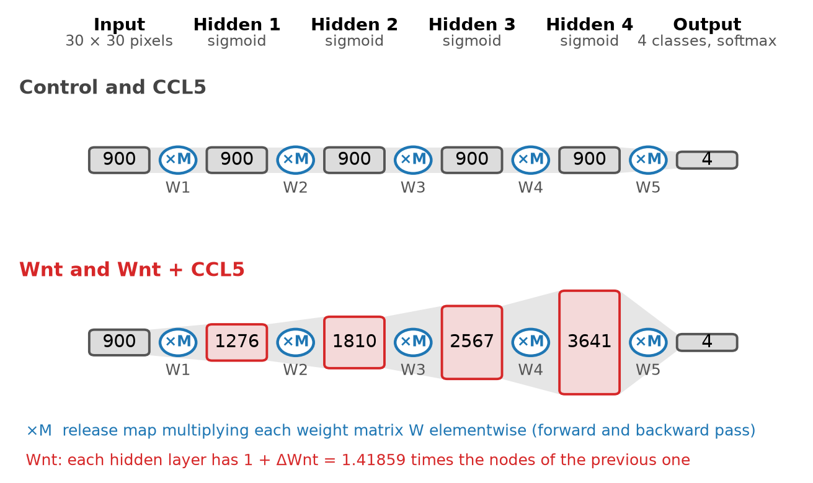
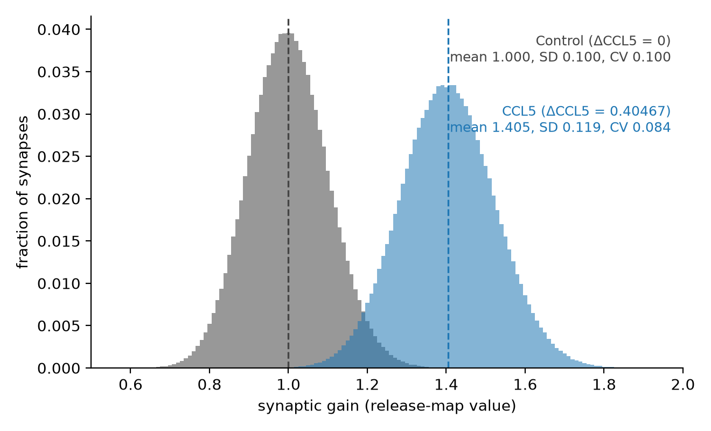
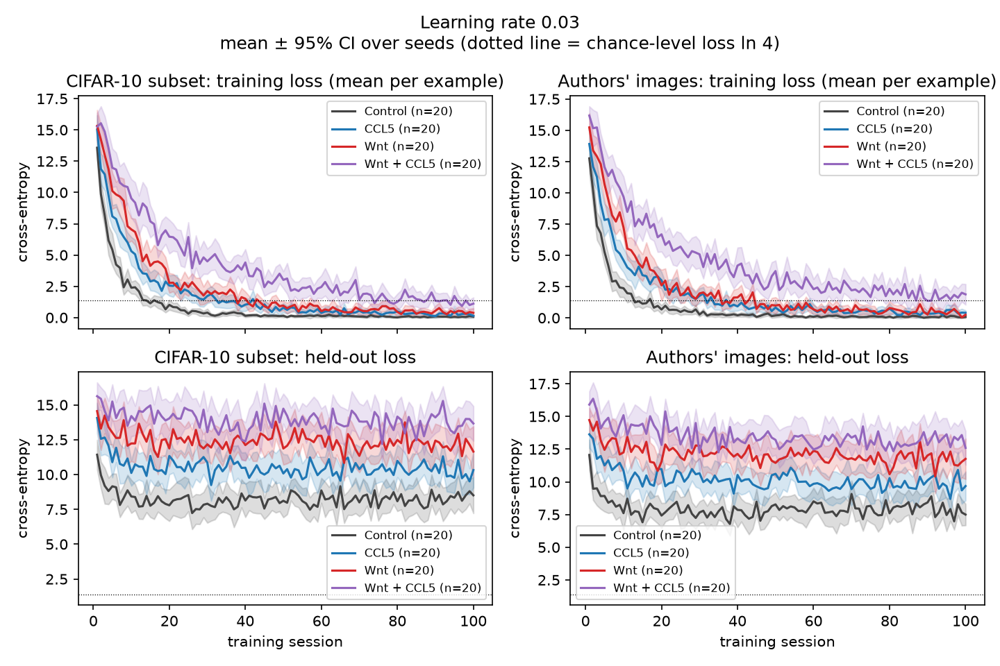
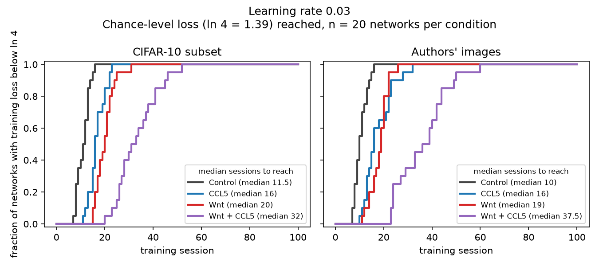
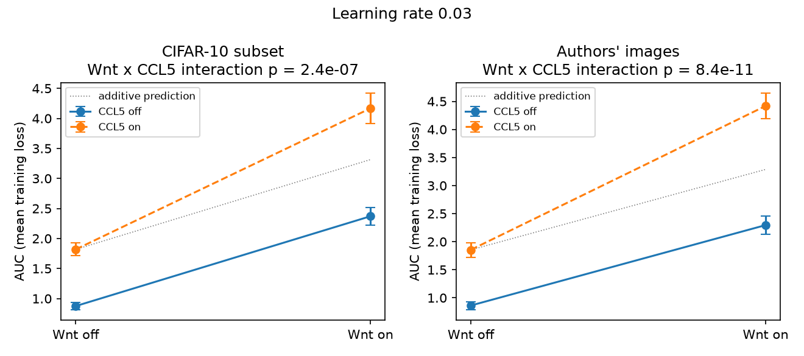
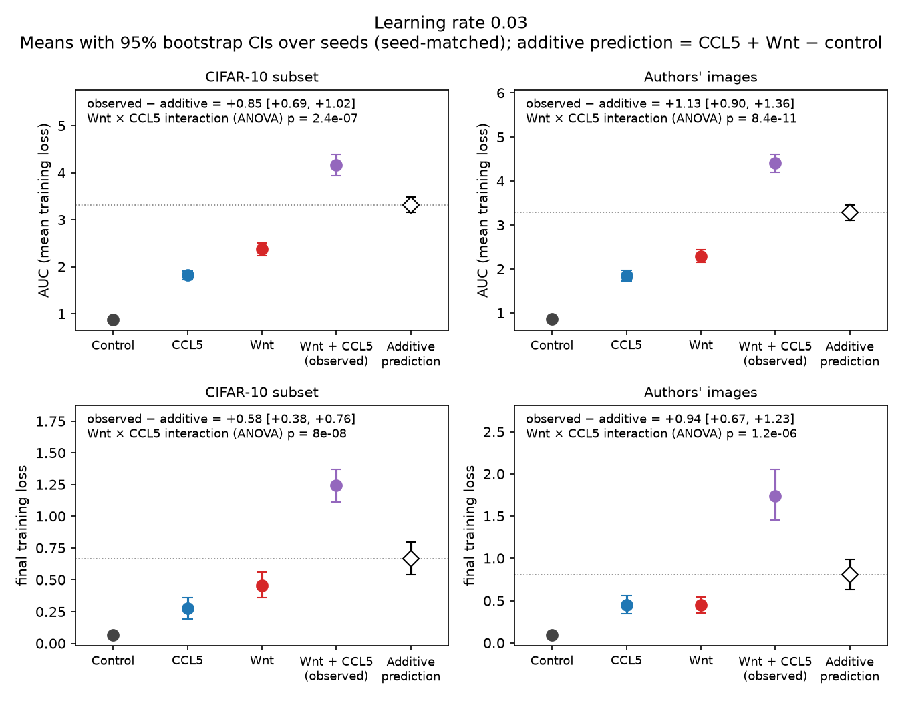
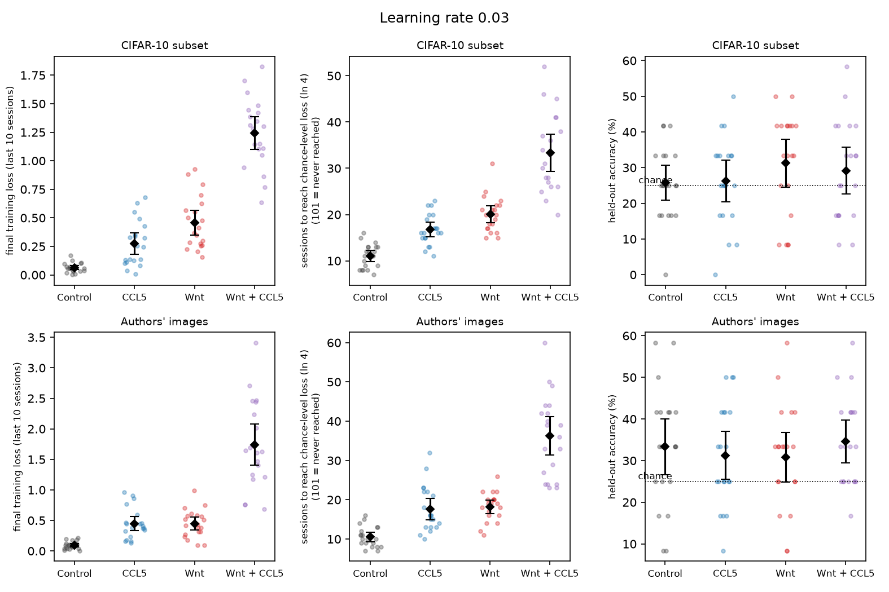
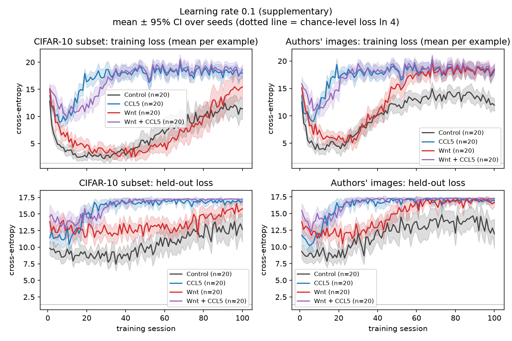
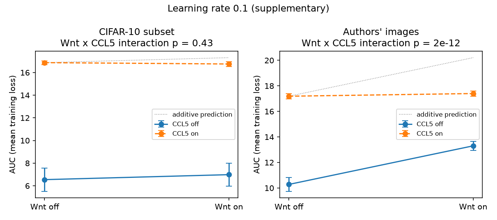

# Modeling the effects of the Wnt and mTOR signaling pathways on ASD-impacted visual processing using neural networks to reflect population dynamics

Rithvik Marri1, John Amodeo2

1.&nbsp;&nbsp;American Heritage School Broward 2.&nbsp;&nbsp;Duke University

**Keywords:** ASD, neural network, Wnt pathway, mTOR pathway, long-range signaling

## Abstract

Autism spectrum disorder (ASD) is a highly heterogeneous disorder, but two pathways, Wnt and mTOR, have been identified as significantly high-risk. The Wnt pathways produce Wnt proteins that stabilize synapses, and mTOR activates CCL5, which stimulates glutamate release. These two proteins in excess cause unnecessary synapses to form and survive, a key hallmark of ASD. We aimed to create a neural network model that uses visual processing as a base to examine the effects of the two proteins at ASD levels. In the model (images presented in shuffled order, a softmax output, held-out evaluation, and 20 independently seeded networks per condition), we found that both perturbations slowed the reduction of training loss relative to the control, and that the two perturbations together slowed learning more than the sum of their separate effects. Classification of held-out images stayed close to chance in every condition because the training sets were very small, so the model is informative about learning rather than about classification accuracy. This type of model can be used in future research to study population dynamics and signaling molecules in neurological disorders.

## Introduction

Autism spectrum disorder (ASD) is a heterogeneous neurodevelopmental disorder with symptoms related to social interaction, communication, and hypersensitivity1. Vision, particularly, is one of the main senses impacted by patients with ASD2. The prevalence is increasing, and it is one of the more common childhood development disorders today3. ASD has a complex genetic etiology with hundreds of genes that are implicated in the pathology, but there are two pathways, the Wnt pathway and the mTOR (mechanistic target of rapamycin) pathway, that are found to be increasingly high risk for the disorder. More specifically, the increase of Wnt proteins and the mTOR-activated release of CCL5 (chemokine ligand 5) protein are found in patients with ASD4,5. Both of these proteins have been studied in isolation and at the cell-to-cell level. However, the crosstalk between the two proteins and their involved pathways lacks research. Additionally, current research does not include the potential study of these pathways in terms of population dynamics. Because much of the brain is interconnected and constantly communicating, considering long-range signaling for the pathways could be crucial to improving understanding.

For this study, we aim to model the effects of the increased concentrations of both the Wnt and CCL5 proteins in visual processing by leveraging a neural network to capture neuronal communication. Using computational techniques allows for a more accessible form of study that still reflects human biology. By creating, testing, and analyzing this model, we aim to understand the impact of these specific proteins on ASD at the neuronal level as well as set up potential avenues for future research. 

## Literature Review

To study the role of CCL5 and Wnt proteins on the molecular signaling level of ASD with respect to the visual pathway, it is important to consider aspects of signal transduction. Namely, the diffusion of the signaling molecule, the receptor binding, the intracellular cascade, and finally the neuronal activity in response are events that require further explanation. Understanding how ASD pathology affects these functions is crucial to modeling how these networks are dysfunctional in patients with ASD. Both signaling pathways, WNT and mTOR, have roles in synaptic function and neuroplasticity, roles that are changed in the circuitry of patients with ASD4,5. The impact of altered levels of Wnt proteins and CCL5 on plasticity through synaptic stability and release probability, respectively, is necessary to show the effects in the model and the result on visual processing. 

### mTOR-activated CCL5

CCL5 is a C-C chemokine, a class of small proteins present throughout the body and the brain that is potentially involved with neurotransmission and modulation6. It is usually implicated in cell migration and intercellular communication, along with central neuroinflammation7. CCL5 binds to C-C chemokine receptors, G-protein coupled receptors that are located on microglia, astrocytes, and even neurons, which were previously thought to not have these receptors. CCL5 mainly acts as a ligand for the CCR1, CCR3, and CCR5 subtypes7. The expression of CCL5 is regionalized within the CNS and is highest in white matter concentrated in glia and myelinated axons. But it is also present in the cerebral cortex and hippocampus, even without inflammation8.

In relation to ASD, CCL5 has been shown to have a statistically significant relationship with hyperactivity and other symptoms of ASD1. The abnormal mTOR pathway in ASD can increase CCL5 production9. This is done because mTOR phosphorylation is elevated in the biology of patients with ASD. The mTOR activation then down-regulates the phosphorylation of glycogen synthase kinase-3 beta (GSK-3β), which proceeds to reduce the phosphorylation of cAMP response element-binding protein (CREB). Because of this process, less CREB is available to bind with CREB-binding protein (CREBBP) within the nucleus, which opens up the nuclear factor kappa-light-chain-enhancer of activated B cells (NF-κB) to bind to CREBBP instead. NF-κB binding with CREBBP results in the overexpression of CCL510.

After being released, CCL5 reaches neurons through volume diffusion and modulates neuronal activity through paracrine signaling, which is mediated by the expression of CCRs in neurons. Diffusion can only happen when the extracellular concentration of CCL5 is high enough to ensure crossing across synaptic space. Once CCL5 binds to a CCR subtype, usually PTx-sensitive GCPRs, it induces a change in G proteins. The G proteins then lead to phospholipase C (PLC) translocation, hydrolysis of phosphoinositides, and inositol triphosphate (IP3)/diacylglycerol (DAG) production. This cascade then causes the mobilization of Ca2+ ions, eventually activating protein kinase C (PKC). PKC then begins phosphorylation processes that increase glutamate vesicle exocytosis into the synaptic cleft11. Increased glutamate results in excitotoxicity, or the toxicity that arises from excitatory molecules, which can then have various negative effects on forming connections, an aspect of ASD that is discussed further. 

### Wnt proteins from the WNT signaling pathway

Mutations in several WNT ligands, including WNT1, WNT2, WNT3, and WNT9B, have been connected with ASD. A WNT1 missense variant present in ASD etiology can activate WNT/β-catenin signaling, and elevated levels of WNT expression have been documented in patients with ASD. This evidence suggests that the overactivation of the WNT signaling pathway is a factor in ASD pathogenesis5. The hyperactivation of WNT signaling can lead to neurodevelopmental defects with neuron migration, cell fate specification, and dendrite and synapse formation or function12. The combination of perturbed pathways along with the WNT pathway can give rise to emergent symptoms and behaviors associated with ASD13. It is important to understand the function and transduction of Wnt proteins within this pathway before applying it to a visual processing model.

Wnt proteins are glycoproteins that act both short- and long-range. They bind to multiple receptors, including Ror and Ryk tyrosine kinases, but mainly bind to Frizzled (Fz) receptors. This binding results in the activation of protein kinase A (PKA) and an increase in extrasynaptic AMPA receptors (AMPARs) through the phosphorylation of the GluA1 subunit of AMPARs at serine 845. Wnt then plays a role in the migration of the extrasynaptic AMPARs by lateral diffusion. The Fz binding also activates calcium/calmodulin-dependent protein kinase II (CaMKII), which phosphorylates synaptic Ras GTPase-activating protein (SynGAP) and activates Ras-ERK signaling. These processes, along with the influx of Ca2+ ions, trigger actin cytoskeleton reorganization to regulate the growth of dendritic spines and the level of AMPARs14,15.

Presynaptic development is also affected by Wnt signaling. Wnts increase synapsin 1 levels, a protein involved with the creation and function of synaptic vesicles and the induction of growth cone expansion. Wnts are also involved with axonal spreading and the growth of cone size, done through loops of microtubules at the cone16,17. Interestingly, the gene SYN2, coding for the protein synapsin 2, is upregulated with enhanced WNT signaling and impairs learning and memory, similar to ASD-like behaviors15. A different function of Wnts at the synapse has been demonstrated, involving the increase in functional GABAA receptors (GABAA-Rs), which are highly recycled and positively correlated to synaptic strength18. 

### Neurotransmitter release and synaptic stability in regard to neuroplasticity

ASD is heavily implicated in abnormalities in plasticity19, which is crucial to the control of the connections made in the CNS and specifically in the visual processing pathway. It is then important to understand how the dysfunctional mTOR and WNT signaling pathways present in ASD can have detrimental effects on neuroplasticity. Specifically, the signaling molecules of CCL5 and Wnt proteins have an effect on this process, and identifying their roles is important for building a model.

As discussed earlier in this section, the elevated levels of CCL5 due to the abnormal mTOR pathway can lead to an increase in excitatory neurotransmitter glutamate. This causes excitotoxicity and the overexcitation of ionotropic glutamatergic receptors like NMDA and AMPA receptors. The resulting increase in calcium ion concentration in the cytosol activates the inducible isoform of NO synthase, increasing nitric oxide concentration and phosphorylating PKC and phospholipase A2. These events proceed to the enhancement of lipid peroxidation, and free radicals inhibit oxidative phosphorylation, triggering an apoptosis cascade. The ATP products, like 4-hydroxynonenal (4-HNE), may then interact with synaptic proteins and disturb the transport of glucose and glutamate, making the neurons more sensitive to excitotoxicity. The corresponding imbalance of excitation and inhibition causes new properties to appear in a neural network20.

Wnt proteins also play a role in synaptic plasticity. Wg, part of the Wnt family of proteins, has been released from presynaptic boutons when activity is stimulated, as well as eliciting changes in synaptic functions and dynamics21. This evidence suggests a role for Wnt in activity-mediated plasticity. The role in question was supported with more evidence, as mossy fiber axon terminals developed in an enriched environment were similar to Wnt-induced mossy fiber granules at cerebellar synapses22. More specifically, Wnt has also been found to be involved with long-term potentiation (LTP), a well-studied process of plasticity. This is evidenced by the reintroduction of Wnt, initially withheld from hippocampal neurons, rapidly increasing dendritic spine growth, AMAPAR recruitment, and synaptic strength, like in the early stages of LTP23.

Considering all of the information reviewed so far, it allows for the informed construction and modification of a visual processing model that can be influenced to reflect the changes present in ASD.

## Methods

To effectively represent the pathways and the corresponding connections made in the brain, the chosen method is to create and test an artificial neural network that receives visual input in the form of image classes and assigns the most probabilistic class a set of images belongs to. The model has to be able to be adjusted for the increased levels of CCL5 and Wnt proteins that are found in patients with ASD to understand the effect these two pathways can have on visual processing.

### Overview

The model is built in the Python coding language (version 3.11). The initial input for the model is a set of images separated by the categories of dogs, cats, cars, and trucks. In the categories, there is a training subset through which the neural network works, and then a held-out testing subset, never used for training, where the accuracy and loss of the neural network are measured. Specifically, in the training phase, the neural network is given both the image and the label (the category the image is in) and trains to reduce the loss between the predicted label and the actual label. The training sessions and the loss for each session are recorded and graphed. Then, in the testing phase, the neural network is given only the image and asked to predict the label, with the accuracy of these predictions represented as a percentage output.

Two image sets were used in this analysis, each with three training and three held-out test images per class (12 + 12 images): a set of images collected by the authors (not redistributed with the code), and a subset of CIFAR-10 (the first three images of each of the classes automobile, cat, dog and truck, which are named cars, cats, dogs and trucks in the model, from the first CIFAR-10 training batch for training and from the test batch for testing). The CIFAR-10 subset can be regenerated automatically by the accompanying code.

This neural network is coded to run similarly to how human visual processing is done. It attempts to model the connections made in a human brain that are involved with vision and its aspects. As identified earlier, in an ASD brain, there are elevated levels of both CCL5 and Wnt proteins that influence both synapses and neurotransmitter release. CCL5 influences the release of glutamate, an excitatory neurotransmitter that is crucial to memory and neuroplasticity. Wnt proteins have a positive effect on synaptic stability and allow for more synapses to stay active. However, in typical development, the number of synapses is pruned back naturally. In ASD brains, there is a surplus of synapses due to the failure of pruning mechanisms24. To reflect this difference in the brains of patients with ASD, the fold changes for CCL5 and Wnt are independent variables that can be adjusted in the model and have a corresponding effect on the underlying neural network nodes, layers, and connections. Pruning itself is not simulated: the model represents its failure only through the surplus of nodes and connections described below.

### Visual Input

For the computer to actually process the images that are being fed through the network, each image is converted into a form that contains usable data. The image is converted to a matrix of numbers based on pixel light intensity and RGB (red, green, and blue) values. The conversion is done with a function from the OpenCV library that was installed as a package and imported into the code. The matrix is then converted from RGB values to grayscale and resized through similar functions. Once resized, the matrix entries are converted to percentages of 255 so they can be accurately compared and then flattened down to a vector with one entry per pixel (900 x 1 in all runs reported here, from 30 x 30 images). Each matrix is encoded with its label from the image classes in a dictionary that allows the label to be called back from the class itself. This will later be used in the training and testing phases of the neural network.

### Neural Network

The first action the code takes for the model is to initialize the components of the neural network: the layer sizes, weights, and biases. The weights and biases are randomly generated (from a standard normal distribution) and then modified in the training phase to become more accurate. The initialization takes a few parameters from the user to set up the network: the class list, image vector size, and hidden layer number. The image vector size determines the number of nodes in the input layer. Each node holds something unique about the image and passes it on to subsequent nodes. The next layer in the network, one of the hidden layers, has the same number of nodes as the previous layer. In the idealized network, this would mean that any one pixel in the image is primarily represented by one node in a layer. In the implementation used here, adjacent layers are fully connected: every node receives a weighted input from every node of the previous layer, with initial weights drawn at random, so one-to-one correspondence is the conceptual motivation for equal layer sizes rather than a constraint on the weights. The values are scaled by the distinct weight matrices before moving on to the next layer. The number of hidden layers is defaulted to 4, and both the hidden layer number and the image vector size can be changed to test different cases and variables. The signals between these layers are then sequestered into a final layer. The final layer, or output layer, has a size determined by the class list. The class list itself is a list of the image labels, which are also the names of the folders containing the images for training and testing. There are four total classes, so using all of them in the class list would result in an output layer with four nodes and the corresponding data. This data is in the form of probabilities of the image being in one of the classes, with the highest probability taken to be the predicted class. In this idealized neural network, the input layer and all the hidden layers would not transfer redundant information if connections were one-to-one. This is reminiscent of biological neural networks evolving to eliminate redundancy to become more efficient.

However, the presence of excess Wnt proteins facilitates the formation of more synapses than typical Wnt concentrations. In this model, the increased Wnt concentration in ASD is accounted for by the variable ΔWnt, or the fold change in the Wnt concentration of a patient with ASD compared to a typically developing child. For example, a ΔWnt value of 0.5 would mean a 1.5-times greater Wnt concentration than the norm. This means a ΔWnt of 0 is the default. The value of ΔWnt is then used to scale up or down the downstream layer by multiplying the upstream layer by the value to find how many nodes are added or removed (for ΔWnt = 0.41859 and 900 inputs, the four hidden layers have 1276, 1810, 2567 and 3641 nodes). This process creates additional nodes and connections: the downstream layer has more nodes than the upstream layer, so several nodes can carry information about the same pixel. More connections in this modified network are similar to those in ASD patients, who have more synapses than necessary. The identified fold change of Wnt proteins in ASD was determined in previous studies by isolating the expression of high-risk genes and found to be 1.41859 times the normal concentration25, so ΔWnt = 0.41859 for the ASD condition.

The architecture of the model and the points at which the two perturbations act on it are summarized in Figure 1.

<figure>

<figcaption><b>Figure 1.</b> The network. An input of 900 pixels (30 × 30) feeds four hidden layers of sigmoid units and a four-class softmax output. In the control and CCL5 networks every hidden layer has 900 nodes; with the ASD value of ΔWnt (0.41859) the hidden layers have 1276, 1810, 2567 and 3641 nodes (Wnt and Wnt + CCL5 networks). CCL5 acts on all five weight matrices W, including the one into the output layer: each is multiplied elementwise by a release map M that is redrawn on every pass and used in both the forward and the backward pass. Box heights are proportional to the number of nodes (output layer not to scale).</figcaption>
</figure>

Once the feedforward portion of the model is complete, there is a feedback component that updates weights and biases based on the error found in the predicted class. The encoded image label is subtracted from the output layer (the class probabilities) to get a difference matrix that is then propagated backwards through the network. This difference matrix is multiplied by the transposition of the weight matrix between the final hidden layer and the output layer (the weights as scaled by the CCL5 release maps described below, so that the same weights are used going forwards and backwards) and scaled by a number found by [activity of the last hidden layer * (1-the activity of the last hidden layer)] to get another difference matrix. The process is then repeated through all the hidden layers. Each difference, or delta, matrix is made into one long vector that then has its individual values squared, summed, and square-rooted to produce a single value called the Euclidean norm. If this norm is too large, it's clipped by a preset max gradient norm value that keeps the delta values small enough for backpropagation.

The layer deltas update the weights in each layer by multiplying the delta by the transposition of the layer activity (and, because the weights act through the release maps, by the release map of that layer). The values in the resulting matrix are multiplied by an already inputted learning rate and subtracted from the existing layer weight matrix. All main results use a learning rate of 0.03; a learning rate of 0.1 makes training unstable in every condition (see Results) and is reported in the Supplementary Material. Updating the biases is done in a similar way, with the scaled delta matrix being subtracted from the existing biases matrix instead. The cross-entropy loss of the output layer compared to the encoded image label is calculated by taking the natural log of the node values, multiplying by the encoded image label to zero out incorrect values at the wrong image class, and converting it to a positive value. This value is then returned as a loss by the model.

### Training and Testing

Once the initialization, feedforward, and feedback components are defined, the model can then be trained and tested with the images in the different image classes. The training phase is where the neural network learns to classify images according to the specific class labels with which they are paired. Training takes a session count and repeats the neural network over the specified number of sessions. In each session every training image is used once, in a freshly shuffled order that mixes the classes, so that the network cannot lower its loss simply by tracking the class it has seen most recently. Each image is fed through the feedforward part of the neural network, which returns a list of layer activities. Once this process occurs, the layer activities and encoded label images are passed through the feedback operation, returning the loss for each image. The mean loss per image is found for the whole session and then plotted to show the change in loss over the session count.

After every session (and at the end of training) the neural network is also evaluated, without any weight update, on the held-out set of images that are still separated into the various classes. These images are passed through the feedforward function of the network, and the output layer activity list is received. The predicted class is the output node with the highest class probability, and the trial is a success if this node is the one that carries the image's label. After testing runs through all the images, it returns a percent accuracy out of all trials, and the held-out loss is the mean cross-entropy over the same images. Because there are four classes, chance accuracy is 25%. The same release maps (below) are applied during training and testing.

### Network Tuning

Several functions are also at play within the neural network to represent the effect of the CCL5 concentration increase as well as create comparable data values at the nodes in each layer. The dimensions of the weight matrix are used to create a matrix of random values, defined as release maps, with the same dimensions. Importantly, these random values are selected from a Poisson distribution whose mean is set by ΔCCL5: each entry is a Poisson random variable with mean 100(1 + ΔCCL5), divided by 100, and the maps are redrawn on every pass. Similar to the ΔWnt value, which was the fold change of Wnt concentration in patients with ASD compared to typically developing children, ΔCCL5 is the fold change of CCL5 concentration. This value has been measured in several clinical trials and found to be 1.40467 times the normal concentration3,26. So the ASD value of ΔCCL5 would be equal to 0.40467. Poisson distributions have been found to simulate the stochastic release of neurotransmitters at synapses, and increased CCL5 concentration also results in increased excitatory neurotransmitter release, so centering the Poisson distribution at the new value of CCL5 would best replicate the effect on neurotransmitter release. The control network therefore also has stochastic release, with maps of mean 1.00 and standard deviation 0.100, whereas the ASD value of ΔCCL5 gives maps of mean 1.405 and standard deviation 0.119. Because the standard deviation of a Poisson variable grows only with the square root of its mean, the CCL5 maps have a larger average gain and a slightly larger absolute spread but a slightly smaller relative spread (coefficient of variation 0.084 versus 0.100 in the control). The new release maps are multiplied by the existing weight matrices to scale the numbers and connections made between nodes similar to biological connections, and the scaled weights are used in both the forward and the backward pass of training.

The distributions of the release maps for the control and for the ASD value of ΔCCL5 are shown in Figure 2.

<figure>

<figcaption><b>Figure 2.</b> Release-map values (synaptic gain) for the control (ΔCCL5 = 0) and CCL5 (ΔCCL5 = 0.40467) networks: 1,000,000 values for each, drawn with the sampling function of the model. Dashed lines are the means; the mean, standard deviation (SD) and coefficient of variation (CV) of the sampled values are given in the panel. Values are multiples of 0.01 because they are Poisson counts divided by 100.</figcaption>
</figure>

A sigmoid function is also applied to the layers in the network. The function is defined below. This function uses a node value as the negative exponent of Euler's number, adds 1 to that new value, and then divides this whole result out of 1 to make each node between 0 and 1 and maintain their relative differences. Once the output layer is produced, a softmax function is applied to the layer. First, the largest node value is found and then subtracted from each node. These following negative values are used as the negative exponents of Euler's number and then divided by the sum of all the values to determine the percentage of which each one contributes to the sum. The updated layer is returned and now contains node values between 0 and 1 that sum to 1. Whichever node value is the highest is treated as the predicted image class, which is then used for training and testing.

### Data Analysis

Once the training sessions are complete, the loss for each session is returned and printed. These values are also taken as a mean of all the images and plotted in a graph, with the x-axis being the training session number and the y-axis being the mean loss per image. These values are also returned in spreadsheet form for better analysis. There are four main model runs forming a 2 x 2 design: the control with both ΔWnt and ΔCCL5 values being 0 indicating normal concentration, ΔWnt being at ASD levels and ΔCCL5 at 0, ΔWnt at 0 and ΔCCL5 at ASD levels, and both at ASD levels. Each condition was run with 20 independent random seeds on each image set, using the same seeds in all four conditions (a given seed gives the same image order in every condition and, for the control and CCL5 networks, the same initial weights; the Wnt networks have different layer sizes and so cannot share initial weights).

The analysis plan was specified before the runs were made. The main measure of how efficiently a network learns is the area under the training-loss curve (AUC, here the mean training loss over the 100 sessions; lower values mean faster loss reduction). Additional measures are the final loss (sessions 91–100), the number of sessions needed for the loss to fall to the chance level for four classes (ln 4 = 1.39), the number of sessions needed to fall to half of the first-session loss, and held-out accuracy and loss. The effects of Wnt, CCL5 and their interaction on these measures were tested with two-way analyses of variance with the seed as the replicate, with partial η² as the effect size. Each perturbed condition was also compared with the control with a one-tailed two-sample (Welch) t-test of the hypothesis that the control mean is smaller, with a Holm correction for the three comparisons and Cohen's d (with a bootstrap 95% confidence interval) as the effect size; the interaction was additionally checked with a permutation test within seeds. Held-out accuracy was compared with chance (25%) with one-sample t-tests. Values below are means with 95% confidence intervals over the 20 seeds.

## Results

All model runs were conducted with an image vector size of 900 and 100 training sessions.

### Choice of learning rate

A learning rate of 0.1 does not give stable learning in any condition, including the control: the control's training loss first falls to about 2.5–4 and then climbs back to about 11–13, and held-out accuracy stays at chance (Supplementary Material, Figures S1 and S2). The cause is the scale of the network: with weights initialized from a standard normal distribution and 900 or more inputs per node, the output values before the softmax are large, so a step of 0.1 can flip the predicted class. To obtain a stable comparison, a learning rate was chosen in a pilot on control networks only, before any perturbed network was run with it (three seeds not used elsewhere, both image sets, learning rates 0.1, 0.03, 0.01, 0.003, 0.001): the rate with the lowest final control training loss was 0.03 (final loss 0.15 and 0.03 on the authors' and CIFAR-10 sets, versus 12.0 and 10.4 at 0.1). All results below use 0.03.

### Training loss

With a learning rate of 0.03 all networks learn, and the perturbed networks learn more slowly than the control in both image sets (Figure 3, Figure 4, Tables 1–3). The control network reached the chance-level loss in {{S:original:control:ept_abs}} sessions on the authors' images and {{S:cifar3:control:ept_abs}} sessions on CIFAR-10, whereas the CCL5 networks needed {{S:original:ccl5:ept_abs}} and {{S:cifar3:ccl5:ept_abs}}, the Wnt networks {{S:original:wnt:ept_abs}} and {{S:cifar3:wnt:ept_abs}}, and the networks with both perturbations {{S:original:both:ept_abs}} and {{S:cifar3:both:ept_abs}} sessions.

The area under the training-loss curve was {{S:original:control:auc}} for the control on the authors' images, compared with {{S:original:ccl5:auc}} (CCL5), {{S:original:wnt:auc}} (Wnt) and {{S:original:both:auc}} (both); on CIFAR-10 it was {{S:cifar3:control:auc}} for the control, {{S:cifar3:ccl5:auc}}, {{S:cifar3:wnt:auc}} and {{S:cifar3:both:auc}}. Every perturbed condition was higher than the control (the authors' images: CCL5 {{D:original:auc:ccl5}}; Wnt {{D:original:auc:wnt}}; both {{D:original:auc:both}}; CIFAR-10: CCL5 {{D:cifar3:auc:ccl5}}; Wnt {{D:cifar3:auc:wnt}}; both {{D:cifar3:auc:both}}). The final training loss followed the same order, and the percentage decrease in mean loss from the first session to the end of training was {{PCT:original:control}} (control), {{PCT:original:ccl5}} (CCL5), {{PCT:original:wnt}} (Wnt) and {{PCT:original:both}} (both) on the authors' images, and {{PCT:cifar3:control}}, {{PCT:cifar3:ccl5}}, {{PCT:cifar3:wnt}} and {{PCT:cifar3:both}} on CIFAR-10. The mean loss in the first session (averaged over that session's updates) was also somewhat higher in the perturbed networks (Table 1), so part of the difference is present from the start; the largest differences, however, develop over the following sessions (Figure 3).

<figure>

<figcaption><b>Figure 3.</b> Training loss (top) and held-out loss (bottom) over 100 training sessions for the four conditions on the authors' images (right) and the CIFAR-10 subset (left); lines are means over 20 seeds and bands are 95% confidence intervals. The dotted line is the chance-level loss, ln 4. Learning rate 0.03.</figcaption>
</figure>

Every network reached the chance-level loss within the 100 sessions (Figure 4). The delay was not confined to a few slow networks: the slowest control network needed 16 sessions on both image sets, fewer than the fastest network with both perturbations (20 sessions on CIFAR-10, 23 on the authors' images), and the networks with both perturbations were also the most variable, with the slowest needing 52 and 60 sessions.

<figure>

<figcaption><b>Figure 4.</b> Fraction of the 20 networks in each condition whose training loss had reached the chance-level loss (ln 4 = 1.39) by each training session, for the CIFAR-10 subset (left) and the authors' images (right). Learning rate 0.03.</figcaption>
</figure>

Table 1. Summary statistics by condition (mean ± 95% CI over 20 seeds; learning rate 0.03).

{{TABLE:summary}}

### Interaction between Wnt and CCL5

The two perturbations amplified each other: with both perturbations the AUC was larger than the sum of the effects of each alone (Figures 5 and 6). On the authors' images, the control AUC plus the separate increases from CCL5 and from Wnt would predict about 3.3, but the observed AUC with both perturbations was {{M:original:both:auc}}; on CIFAR-10 the additive prediction was also about 3.3 and the observed value {{M:cifar3:both:auc}}. In the two-way analysis of variance of the AUC, the Wnt × CCL5 interaction was significant on both image sets (the authors' images: {{F:original:auc:Wnt x CCL5}}; CIFAR-10: {{F:cifar3:auc:Wnt x CCL5}}), in addition to the main effects of Wnt (the authors' images: {{F:original:auc:Wnt}}; CIFAR-10: {{F:cifar3:auc:Wnt}}) and CCL5 (the authors' images: {{F:original:auc:CCL5}}; CIFAR-10: {{F:cifar3:auc:CCL5}}). The interaction was also significant for the final loss and for the number of sessions to reach the chance-level loss, but not for the number of sessions to reach half of the first-session loss (Table 2). The interaction was less certain under a within-seed permutation test of the AUC (the authors' images p = 0.11, CIFAR-10 p = 0.18) and on the logarithm of the AUC for the authors' images (p = 0.12; CIFAR-10 p = 0.006), so the size of the interaction depends on the scale on which it is measured, whereas the finding that both perturbations together are the slowest learners does not.

<figure>

<figcaption><b>Figure 5.</b> Area under the training-loss curve (mean ± 95% CI over 20 seeds) for Wnt off/on, with CCL5 off (solid) and on (dashed). The dotted line is the prediction if the effects of Wnt and CCL5 simply added. Learning rate 0.03.</figcaption>
</figure>

Figure 6 shows the same comparison with the observed value for both perturbations set against the additive prediction (the CCL5 value plus the Wnt value minus the control value), with 95% bootstrap confidence intervals over seeds, for the AUC and the final loss. The observed values exceeded the additive prediction by +0.85 [0.69, 1.02] (CIFAR-10) and +1.13 [0.90, 1.36] (authors' images) in AUC, and by +0.58 [0.38, 0.76] and +0.94 [0.67, 1.23] in final loss; none of these intervals includes zero.

<figure>

<figcaption><b>Figure 6.</b> Observed and additive effects of Wnt and CCL5 on the AUC (top) and the final training loss (bottom). Points are means over 20 seeds with 95% bootstrap confidence intervals (seeds resampled together across conditions); the open diamond is the additive prediction, CCL5 + Wnt − control. The annotation gives the observed minus additive difference with its 95% interval and the p-value of the Wnt × CCL5 interaction in the analysis of variance. Learning rate 0.03.</figcaption>
</figure>

Table 2. Two-way analysis of variance (Wnt, CCL5, Wnt × CCL5; 1 and 76 degrees of freedom).

{{TABLE:anova}}

Table 3. Each perturbed condition compared with the control (one-tailed Welch test that the control is smaller, Holm-adjusted).

{{TABLE:contrast}}

### Held-out classification

Held-out accuracy stayed close to chance and did not differ between conditions (Figure 7). Mean held-out accuracy on the authors' images was {{ACC:original:control}} for the control, {{ACC:original:ccl5}} for CCL5, {{ACC:original:wnt}} for Wnt and {{ACC:original:both}} for both, and on CIFAR-10 {{ACC:cifar3:control}}, {{ACC:cifar3:ccl5}}, {{ACC:cifar3:wnt}} and {{ACC:cifar3:both}}, with no effect of Wnt, CCL5 or their interaction on accuracy (all p > 0.15; the p-values in parentheses are uncorrected one-sample t-tests against 25%). The small differences from 25% on the authors' images (about 31–35%) are of the size expected from 12 test images per network: each test image is worth 8.3 percentage points of accuracy. The networks do learn the training images (final training accuracy was {{M:original:control:final_train_acc}}% for the control and between {{M:original:both:final_train_acc}}% and {{M:original:ccl5:final_train_acc}}% in the perturbed conditions on the authors' images), but with three training images per class this memorization does not generalize, and the held-out loss, which is dominated by confident wrong predictions, is far above the chance level in every condition (Figure 3, bottom) and, like the training loss, is lowest in the control and highest in the network with both perturbations (Table 1).

<figure>

<figcaption><b>Figure 7.</b> Final training loss (left), sessions to reach the chance-level loss (middle; 101 means not reached) and held-out accuracy (right) for each condition and image set. Small dots are individual seeds, diamonds are means with 95% CI; the dotted line in the right-hand panels is chance (25%). Learning rate 0.03.</figcaption>
</figure>

## Discussion

Several conclusions can be drawn from the results. First and most importantly, the neural network learns more slowly, and reaches a higher loss at the end of the same amount of training, when the Wnt or the mTOR-activated CCL5 concentration is increased, and the effect of both together is larger than the sum of the two. This reflects the true neurobiology as it is modeled here, where increased CCL5 causes more glutamatergic release (represented by a larger and noisier gain on every connection) while excess Wnt proteins help stabilize and allow for new synapses (represented by additional nodes and connections). The control network, compared to the three perturbed networks, was able to reach a low level of loss in the fewest sessions and had the greatest relative decrease.

The effect is on learning and not on classification. Accuracy on held-out images is near chance for all conditions, as expected from such small training sets (see Limitations), so the speed of learning is measured directly, by the area under the loss curve and the number of sessions needed to reach a fixed loss, and it is clearly slower in the perturbed networks.

The two perturbations also interacted. In this model the two perturbations have no direct crosstalk, so the interaction can only arise from how the changes combine in the network (a possible explanation, which we did not test, is that wider layers receiving larger gains are harder to train than the sum of the two changes would suggest); the size of the interaction depends on how it is measured (see Results), and what it means biologically is a hypothesis for future work and not a result of the model.

## Limitations

The main limitation regarding this project is the computing power needed to run neural networks with larger layers and more images. The training sessions were limited to 100 and the layer size to 900 nodes for this project, and the image sets contain only three training and three test images per class. Adding more images would be needed to test classification: with so few images, the networks memorize the training set and held-out accuracy cannot be informative, which is why the model mainly reflects the learning that occurs in ASD during training. The accuracy results here cannot be taken as evidence for or against a classification deficit.

Several features of the model also limit what it can say about biology. The network is fully connected and not one-to-one, so redundancy is represented only by additional nodes and connections; pruning is not simulated; and the effect of CCL5 on glutamate excitotoxicity is not modeled. The networks use standard normal initial weights, a global gradient-norm clip and a learning rate chosen from a pilot on the control, and some of the difference between the Wnt and control networks may reflect that wider layers are harder to train with these settings and not Wnt biology alone; these settings were kept identical across conditions. The release maps of the CCL5 condition have a larger gain and a slightly larger absolute but slightly smaller relative variability than the control's, because the Poisson distribution is parameterized by its mean alone. The learning rate of 0.03 was chosen from a pilot on control networks; the 0.1 results are given as a supplementary analysis.

As a computational model, the results here can only predict and explain certain mechanisms that are part of ASD. It cannot take into account environmental factors such as behavioral therapy or specialized education that can augment the learning of a child with ASD. There is the ability to add more factors and account for environmental changes, but that is beyond the scope of this study.

## Future Research

This project provides a model that is one of the first to incorporate neural networks into ASD modeling. Most research on this topic has been on the cellular or regional level, but using a neural network allows for a larger scale of connectivity, much more similar to that of the brain. ASD or other neurological disorders can be studied in this way because much of the brain works through signaling pathways and long connections. There is also the ability to quantify the effects of molecules important in these pathways, including Wnt and CCL5, as explored here. Wnt and CCL5 combined in this project created an interaction in learning speed that was not seen with either on their own. This type of research can be done with other molecules and signaling pathways that engage in crosstalk, like the Wnt and mTOR pathways. Natural next steps are larger image sets (to test classification), a one-to-one wiring for the control with redundant units for the Wnt condition, and a test of whether the interaction depends on the details of the training settings.

## Conclusion

In creating this model, we aimed to reflect two of the many mechanisms that are intertwined in ASD. The Wnt proteins that are used in signaling of the Wnt pathway and CCL5 activated by the mTOR pathway are found in excess concentrations in children with ASD. CCL5 excess causes the excitotoxicity of glutamate, which plays a key role in plasticity. Elevated Wnt protein levels allow for more synaptic stability and block the pruning of unnecessary synapses.

In this analysis, increasing Wnt, CCL5, or both slowed the reduction of training loss in a neural network of the visual pathway, and both together slowed it more than the sum of the two. This is crucial because it shows that a neural network model can represent aspects of ASD in terms of long-range neuron communication. We do not claim that the perturbed networks classify held-out images less accurately: accuracy was near chance in every condition because the training sets were very small. The effects of these two proteins are important to gain a deeper understanding of ASD mechanisms and are applicable to other pathways implicated in this disorder. It also provides a model that relies on population dynamics, which can be used to learn about and treat ASD network activity.

## References

{{REFERENCES}}

## Supplementary Material

### Results at a learning rate of 0.1

At a learning rate of 0.1 the networks do not learn stably (Supplementary Figure S1), so the comparison at a learning rate of 0.03 in the main text is the one we consider interpretable. For completeness, the perturbed networks again had a higher AUC than the control at this rate on the authors' images (CCL5 {{D:original:auc:ccl5@0.1}}; Wnt {{D:original:auc:wnt@0.1}}) and CCL5 had a higher AUC on CIFAR-10 ({{D:cifar3:auc:ccl5@0.1}}), whereas Wnt did not differ from the control in AUC on CIFAR-10 ({{D:cifar3:auc:wnt@0.1}}). The CCL5 and both-perturbation networks went to a saturated output within about 20 to 40 sessions and had held-out accuracy of exactly 25% (one class predicted for every image). At this learning rate the comparison therefore mostly reflects how quickly each network becomes unstable.

<figure>

<figcaption><b>Supplementary Figure S1.</b> As Figure 3 at a learning rate of 0.1.</figcaption>
</figure>

<figure>

<figcaption><b>Supplementary Figure S2.</b> As Figure 5 at a learning rate of 0.1.</figcaption>
</figure>

